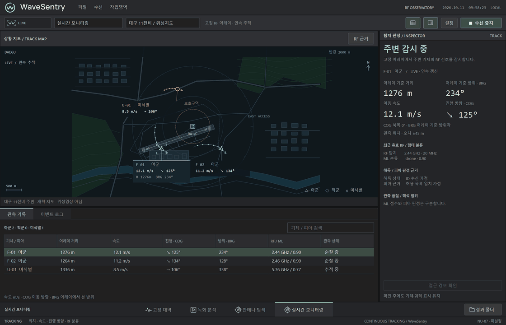
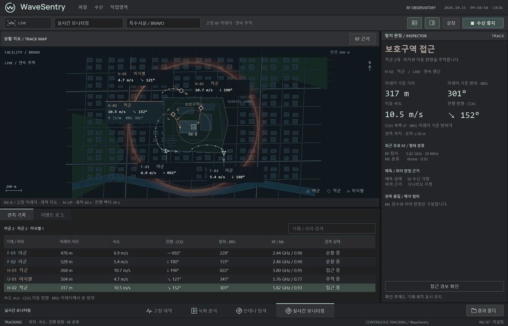
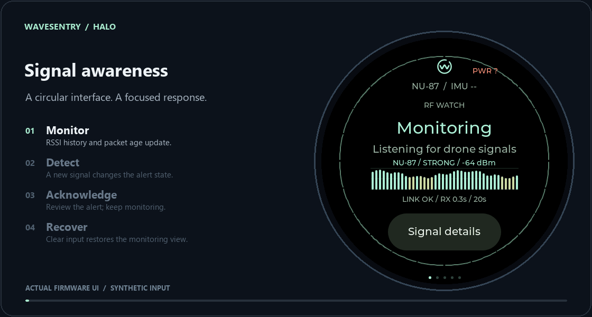
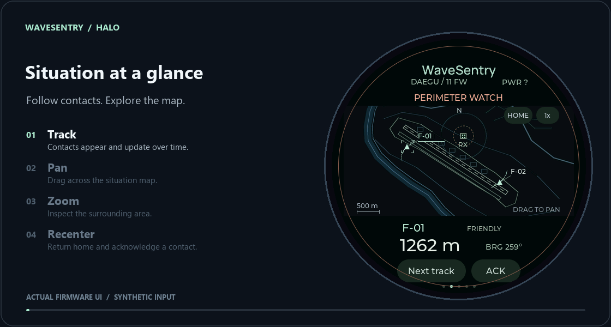

<div align="center">


# WaveSentry

**A Windows workspace for RF observation and drone signal detection.**

Capture signals. Inspect evidence. Follow the situation.

[](https://github.com/GabrielKimm/D4D_WaveSentry/actions/workflows/windows.yml)


[Windows workspace](#inside-the-workspace) · [Halo interface](#halo-interface) · [Quick start](#quick-start) · [Documentation](#documentation)

</div>

<br>



<p align="center"><sub>Actual Windows GUI · synthetic scenario · contact acquisition, tracking, and alert transitions</sub></p>

WaveSentry connects HackRF One reception, training-compatible IQ preprocessing, local inference, and a native desktop interface. Inspect spectra and model inputs, revisit RF candidates across bands, and keep the evidence behind each detection in one workspace.

The animations show the application's **demo mode**, captured from its actual Qt widgets. Tracks, RF scores, and affiliation are synthetic; no radio reception or model inference runs in these previews. The existing GUI uses Korean labels. The maps shown here are offline schematics.

## Inside the workspace

**One selection, shared context.** The map, track list, inspector, and RF panel follow the same selected contact. Pause observations without inventing new positions; resume tracking and acknowledge an alert without stopping the session.



<p align="center"><sub>Linked selection → RF evidence → pause / resume → alert acknowledgment</sub></p>

| Observe | Inspect | Respond |
| :--- | :--- | :--- |
| Fixed-band reception and adaptive 2.4/5 GHz survey | Spectrum, model inputs, detection boxes, and evidence age | Confirmed-detection output to a NU-87 USB indicator |
| Candidate revisits and time-decayed evidence | Searchable observations and synchronized track details | IQ, image, and verdict snapshots for later review |
| Recorded-image inference and hardware-free scenarios | Explicit stale-data, quality, and observation-gap states | Resizable panels and a saved workspace layout |

## Halo interface

**Signal awareness on a circular display.** Halo presents the current detection state, a rolling NU-87 Wi-Fi RSSI chart, and the age of the latest received status. An alert can be acknowledged while the display continues updating.



<p align="center"><sub>Monitor → detect → acknowledge → recover · 20-second RSSI history</sub></p>

**Explore the situation with touch.** Pan across the map, change its scale, return to the home position, and acknowledge a selected contact. The scenario continues to introduce contacts and update range and bearing as the map moves.



<p align="center"><sub>Updating contacts → drag to pan → zoom → recenter → acknowledge</sub></p>

These are captures of the **actual Halo firmware UI running in its LVGL simulator**, with synthetic detection events and radio telemetry. They are not recordings of a physical device or measured RF performance. The map uses a built-in scenario; its positions and affiliations are simulated. In the current Wi-Fi firmware, radio reception runs only on the main screen and is disabled on the map and other pages. Halo firmware is maintained separately from this Windows source distribution.

## Quick start

Use **Windows 11 x64** and **Python 3.12 x64**. Clone into a writable folder, then run in PowerShell:

```powershell
git clone https://github.com/GabrielKimm/D4D_WaveSentry.git
cd D4D_WaveSentry
.\Setup.ps1
.\'Start Demo.cmd'
```

The demo works without a radio or model weights. If Python is not detected, pass `-Python <path-to-python.exe>` to the setup script.

<details>
<summary><strong>Optional: satellite imagery and inference dependencies</strong></summary>

```powershell
# Install verified Cesium assets for the satellite map
.\Setup.ps1 -Satellite

# Install OpenVINO, PyTorch, and Ultralytics for real inference
.\Setup.ps1 -Inference
```

Satellite imagery requires an internet connection. Missing map assets or failed imagery connections fall back to the native schematic map. Imagery is a background reference, not a live camera feed.

For RF operation, provision the model, compatible HackRF DLLs, and USB driver separately. See the [setup guide](docs/SETUP.md) for paths, hashes, environment variables, and NU-87 configuration.

</details>

## Operating modes

| Mode | Purpose | Requirements |
| :--- | :--- | :--- |
| **LIVE** | 2449.5 MHz center, 20 MS/s reception, 10 MHz target-channel decision | HackRF One, model, inference dependencies |
| **SURVEY** | Adaptive observation across 2400–2500 and 5150–5890 MHz | HackRF One, model, inference dependencies |
| **REPLAY** | Local inference over separately supplied 640×640 PNG samples | Model, inference dependencies, replay images |
| **DEMO** | Three map scenarios, continuous tracks, bearing-only and connection-loss states | Base installation; no hardware or weights |

Launch `Start WaveSentry.cmd` for LIVE/REPLAY, `Start Antenna Survey.cmd` for SURVEY, or `Start Demo.cmd` for DEMO.

**Source distribution.** Model weights, measured IQ, replay samples, native DLLs, and device-specific settings are excluded from this repository. The application does not download private models or recordings. Keep supplied assets in the documented local paths or configure their locations through environment variables.

Detection scores and accumulated evidence are not probabilities of drone presence. RF regions are not aircraft counts. Detection range, general false-alarm rates, and field performance require separate evaluation.

## Development

```powershell
.\Setup.ps1 -Dev
.\.venv\Scripts\python.exe -m pytest -q
.\.venv\Scripts\python.exe tools\check_source.py
.\.venv\Scripts\python.exe tools\validate_demo.py
```

The default regression suite runs without hardware, private datasets, or remote imagery. Model identity verification is skipped when weights are absent. Windows CI checks dependency installation, repository contents, regressions, and GUI startup and shutdown.

<details>
<summary><strong>Project layout and preview capture</strong></summary>

```text
main.py                 GUI and headless entry point
d4d/                    RF capture, DSP, inference, decisions, GUI, USB transport
assets/                 Brand assets and satellite map source
vendor/iq_to_image.py    Training-compatible preprocessing reference
tests/                  Core and GUI regression checks
tools/                  Setup support, model export, capture, and validation
docs/                   Setup, architecture, and README media
```

To regenerate the two Windows previews with the native Qt platform:

```powershell
.\.venv\Scripts\python.exe tools\capture_readme.py
```

The capture tool uses the actual demo widgets and a controlled scenario clock at 10 fps. It never starts the radio, model, or USB indicator. Halo previews use the separate firmware's LVGL renderer at its native 466×466 resolution, framed with English captions at 10 fps. See [preview details](docs/media/README.md) for provenance and timing. Only optimized GIFs are published; individual frames and capture reports stay in the ignored `output/` directory.

Runtime state, logs, local settings, models, and samples are excluded from Git. The source check permits only the four documented GIF assets and rejects unexpected binaries, local paths, and credential patterns.

</details>

## Documentation

- [Setup, models, and device configuration](docs/SETUP.md) — Korean
- [Operating modes and architecture](docs/ARCHITECTURE.md) — Korean
- [UNO Q inference pipeline and benchmark notes](docs/UNO_Q_INFERENCE.md) — Korean; separate ClikaRT board experiments and integration plans, not the Windows application's execution path
- [Third-party components and attribution](THIRD_PARTY.md) — English

---

<p align="center"><sub>WaveSentry · RF observation with inspectable evidence.</sub></p>
