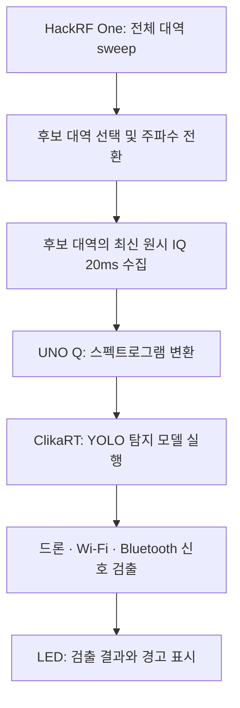

# UNO Q 기반 드론 RF 탐지 파이프라인

작성일: 2026-10-11

> 별도 UNO Q 보드 실험 기록이다. 이 저장소의 Windows 앱은 OpenVINO/PyTorch 경로를 사용하며, 아래 ClikaRT 보드 앱이 저장소에 구현·통합됐다는 의미는 아니다. 기존 앱 구조는 [ARCHITECTURE.md](ARCHITECTURE.md)를 참고한다.

## 핵심 메시지

**약 20MB의 경량 YOLO 모델을 활용해, 소형 UNO Q 보드에서 실제 IQ 데이터의 전처리부터 AI 탐지와 LED 결과 표시까지 수행한다.** 현재 저장된 IQ 재생으로 보드 내 실행을 확인했으며, 목표 운용은 필요한 시점에 20ms씩 관측하는 주기적 탐지다. 전체 sweep과 후보 대역 1개의 분석을 합쳐 약 3초 수준의 결과 갱신을 목표로 하며, 라이브 SDR 연동과 전체 소요 시간 실측은 다음 단계다.

## 파이프라인

위 도식은 목표 라이브 파이프라인이다. HackRF One의 sweep으로 후보 대역을 고른 뒤, 해당 대역의 원시 IQ를 20ms 수집해 UNO Q에 전달한다. Sweep의 주파수별 전력 값 자체를 YOLO 입력으로 사용하는 것은 아니다. UNO Q는 IQ를 시간·주파수 정보를 담은 스펙트로그램으로 변환하고, ClikaRT에서 YOLO 모델을 실행해 신호 영역과 클래스를 출력한다. 결과는 LED 표시로 연결한다. 모델의 박스는 스펙트로그램의 시간·주파수 영역이며, 실제 드론의 위치·방향·거리나 기체 수를 의미하지 않는다.

현재 데모에서는 보드에 미리 저장한 실제 IQ 파일을 읽는다. 스펙트로그램 변환과 추론은 매번 보드에서 수행하며, 미리 계산한 이미지나 검출 결과를 재생하는 방식이 아니다. HackRF의 라이브 IQ 입력 연결은 아직 검증하지 않았다.

## 모델과 ClikaRT 실행 방식

- 학습 모델: `model_02a.pt`, YOLO detection 모델, **20.3MB**.
- 보드 실행 모델: `.pt`에서 변환한 FP32 `model_02a.onnx`, **38.1MB**.
- 입력: RGB 640×640, float32, 배치 1.
- 클래스: `drone`, `wifi`, `bt`.
- 실행: UNO Q Linux 환경의 **ClikaRT 0.6.4 / CPU**.

확인된 경로는 **학습된 .pt → ONNX 변환 → 보드의 ClikaRT 실행**이다. Clika Platform을 통한 모델 배포 완료와 보드의 로컬 ClikaRT 실행 성공은 구분한다. 현재 실행 확인만으로 Platform 배포 성공을 주장하지 않는다.

## 보드 사양과 실측 근거

| 항목 | 확인 내용 | 해석 |
|---|---|---|
| 보드 | UNO Q ABX00173 | 사용 중인 4GB 모델 |
| CPU | Qualcomm Dragonwing QRB2210, Cortex-A53 4코어, 약 2GHz | Linux에서 전처리·AI 추론 실행 |
| RAM | 4GB LPDDR4X | 현재 모델과 앱 실행 가능 |
| 저장공간 | 32GB eMMC | 38.1MB ONNX 모델 수용에 여유 |
| 원본 모델 | 20.3MB `.pt` | 학습 모델 파일 크기 |
| 실행 모델 | 38.1MB ONNX FP32 | 저장공간의 약 0.12% |
| 실행 중 앱 메모리 | 약 276MiB | 반복 실행 중 한 시점의 값이며 최대 사용량은 아님 |
| IQ 전처리＋탐지 | 구간당 약 2.1~2.6초 | IQ 읽기·스펙트로그램 변환·추론 포함, LED 표시 시간 제외 |
| 추론 단독 벤치마크 | 약 0.53 FPS | 전처리·LED를 제외한 CPU 실행 측정 |

보드 사양 출처: [Arduino 공식 UNO Q 데이터시트](https://docs.arduino.cc/resources/datasheets/ABX00162-ABX00173-datasheet.pdf).

추론 단독 벤치마크는 워밍업 2회 뒤 12개 입력으로 측정했다. 중앙 지연시간은 약 1.71초, p95는 약 2.86초다. 현재 결과는 GPU 가속이나 최적화 이후의 성능을 의미하지 않는다.

## 현재 실증과 실시간 처리의 범위

현재 데모는 20MS/s로 수집한 signed int8 I/Q 파일에서 20ms 구간을 읽어 처리한다. 실제 보드 실행에서 미검출·검출 결과와 LED 표시를 확인했고, 사용자가 실물 표시도 확인했다.

사용자가 정한 운용 조건은 **모든 시간을 빠짐없이 분석하지 않고, 20ms씩 주기적으로 관측하는 것**이다. 따라서 연속 IQ 전체를 처리하는 초당 50회 추론은 이 데모의 요구사항이 아니다. 라이브 연결에서는 처리 완료 후 최신 구간을 선택해 과거 데이터의 대기열이 누적되지 않도록 구성한다. 관측 사이에만 나타나는 짧은 신호는 놓칠 수 있으며, 탐지율은 별도 평가가 필요하다.

실측 시간의 대부분은 모델 추론에 사용된다.

| 단계 | 보드 실측 소요 시간 |
|---|---:|
| 저장 파일에서 20ms IQ 읽기 | 약 0.015초 |
| 스펙트로그램 전처리 | 약 0.49초 |
| YOLO 추론 | 약 1.6~2.1초 |
| 합계 | 약 2.1~2.6초 |

**전처리는 약 0.5초, 모델 추론만 약 1.6~2.1초(대략 2초)**다. 두 시간을 합친 보드 처리 시간은 약 2.1~2.6초이며, sweep 시간은 여기에 포함되지 않는다.

### 20ms 신호인데 추론에 약 2초가 걸리는 이유

20ms는 수집한 신호의 시간 길이다. 모델은 그 신호를 변환한 **640×640 RGB 이미지 전체**를 입력으로 받으므로, 신호 구간이 20ms로 짧다고 추론 연산량이 자동으로 줄지는 않는다. 동일한 입력 크기의 이미지를 사용하면 신호 길이만으로 계산량을 판단할 수 없다.

현재 측정은 `.pt` 직접 실행이 아니라, **변환한 ONNX FP32 모델을 ClikaRT 0.6.4의 CPU 모드로 실행**한 결과다. UNO Q의 Cortex-A53 CPU에서 측정했으며 GPU 가속·양자화에 따른 성능 개선은 아직 검증하지 않았다. 모델 파일 크기 20.3MB는 저장 용량을 나타내며, 추론 계산량이나 지연시간을 직접 나타내지는 않는다.

현재 약 2초를 보드의 최적 성능이나 최소 지연시간으로 단정할 수는 없다. 실행 설정·스레드 활용을 점검하고, 모델이 지원하도록 내보내기 설정을 조정한 320×320 입력 등을 비교할 수 있다. 320×320은 입력 픽셀 수가 640×640의 ¼이지만, 속도가 반드시 4배 빨라지는 것은 아니다. 작은 신호 영역의 탐지 정확도와 실제 지연시간을 함께 검증해야 한다. 이 최적화 비교는 아직 수행하지 않았다.

파일 읽기 시간은 라이브 SDR 전송 시간의 실측값이 아니다. 위 합계는 관측된 예시 범위이며 최대 지연시간 보장은 아니다.

## 전체 sweep을 포함한 예상 갱신 시간

후보 대역 1개를 순차 처리한다고 가정하면 다음과 같다.

**전체 sweep 0.75초 → 후보 대역 선택·주파수 전환 → IQ 20ms 수집 → 전처리·추론 약 2.1~2.6초 → 결과 표시**

계산상 `0.75 + 0.02 + (2.1~2.6) = 2.87~3.37초`이므로, **약 2.9~3.4초에 후보 선택·주파수 전환·전송·표시 등의 추가 시간을 더한 값**으로 예상한다. 발표에서는 이를 **후보 1개 기준 약 3초 수준의 탐지 갱신 목표**로 표현한다.

- Sweep 0.75초는 약 6GHz 범위를 8GHz/s로 탐색한 과거 공개 참고값이다. 우리 장비·설정에서 측정한 값은 아니다. 공개 시간 근거 기록 (별도 로컬 실험 기록, 이 저장소에 미포함)
- 후보가 여러 개면 각 대역의 IQ 수집·추론 시간이 추가된다. 후보 선택 방식과 재방문 주기도 정해야 한다.
- 약 3초는 가정에 따른 1회 처리 주기 추정이다. 신호 등장 시점, sweep 관측 여부, 후보 선정과 모델 판정에 따라 발견이 늦어지거나 누락될 수 있어, 전체 대역의 드론을 3초 이내 반드시 탐지한다는 뜻은 아니다.
- 현재 확인된 부분은 저장 IQ 기반 보드 처리다. 라이브 sweep부터 LED까지 연결한 전체 지연시간은 미측정이다.

## 모델 확장성

현재 모델은 보드에 충분히 저장되고 실행되며, 측정 시점의 메모리 사용량에도 여유가 있다. 다만 모델 파일 크기만으로 추론 속도나 더 큰 모델의 실시간성을 보장할 수 없다.

라이브 구현에서는 필요한 탐지 갱신 주기에 맞춰 최신 20ms 구간을 선택한다. 수신·버퍼링과 추론의 분리도 검토한다. 모델 양자화, 입력 크기 조정, 지원되는 실행 최적화도 후보이며, 각 변경 후 탐지 정확도와 지연시간을 함께 측정해야 한다. 이 항목들은 향후 계획이다.

## 발표용 설명

> 20MB급 경량 YOLO 모델을 UNO Q에 탑재해, 실제 무선 IQ 데이터의 스펙트로그램 변환과 AI 탐지, LED 경고까지 장치 내부에서 수행했습니다. 현재 모델은 보드의 메모리와 저장공간에 충분히 수용되며, 클라우드 추론 없이 동작합니다. 전체 대역을 탐색한 뒤 후보 대역의 신호를 20ms씩 관측하는 방식으로, 후보 1개 기준 약 3초 수준의 탐지 갱신을 목표로 합니다. 이는 공개 sweep 참고값과 보드 실측을 합친 예상치이며, 라이브 SDR 연결 후 전체 소요 시간을 검증할 계획입니다.

## 로컬 검증 기록

- 실제 IQ 처리 시간과 자원 사용량 (별도 로컬 실험 기록, 이 저장소에 미포함)
- 보드 런타임 검증 (별도 로컬 실험 기록, 이 저장소에 미포함)
- IQ 입력 8개 구간 보드 검증 (별도 로컬 실험 기록, 이 저장소에 미포함)
- 추론 단독 FPS 벤치마크 (별도 로컬 실험 기록, 이 저장소에 미포함)

## GPU 실행 확인 — 2026-10-11

ClikaRT 0.6.4에서 동일 모델을 Vulkan GPU로 로드했으나 적합한 장치가 없다는 오류로 실패했다. 보드 Adreno 702의 Vulkan device API는 1.0.318이며 ClikaRT 공식 요구사항은 1.2 이상이다. 현재 GPU 추론 성능은 측정하지 못했고 기존 CPU 실행을 유지한다. 진단 기록 (별도 로컬 실험 기록, 이 저장소에 미포함)

## 용어와 실행 엔진 선택

- `.pt`: PyTorch 모델 저장에 흔히 쓰는 확장자. 우리 학습 모델의 원본 파일이다.
- ONNX(오닉스): Open Neural Network Exchange. 모델의 연산과 가중치를 다른 실행 엔진에 전달하는 공통 형식이다. 자체 실행 프로그램은 아니다.
- ClikaRT: Clika의 추론 Runtime. RT는 Runtime을 뜻하며 실시간 성능 보장은 아니다.
- Clika Platform: 장치·모델 등록, 벤치마크와 배포·운영을 관리하는 서비스다.

ClikaRT는 이번 해커톤의 Clika 활용 경로에 맞춰 선택했다. 여러 CPU·가속기 backend를 공통 API로 다루고 Platform과 연계할 수 있다는 장점이 있다. ClikaRT 사용 자체가 자동 경량화·GPU 가속이나 다른 엔진보다 빠른 속도를 입증하지는 않는다.

| 대체 엔진 | 특징 | UNO Q 검토 방향 |
|---|---|---|
| ONNX Runtime | ONNX 실행, 하드웨어별 Execution Provider | 같은 모델의 CPU 성능 비교 후보 |
| ncnn | 모바일·임베디드, ARM CPU·Vulkan GPU 지원 | 모델 변환 후 GPU 호환성 시험 후보 |
| LiteRT (구 TensorFlow Lite) | 모바일·임베디드 추론 | 모델 변환·연산 지원 확인 필요 |
| PyTorch | 학습 모델을 원래 코드와 함께 실행 | 의존성과 성능을 확인해 직접 실행 가능 |

ncnn 공식 FAQ는 Vulkan 1.0/1.1에서도 이론상 동작 가능하다고 설명한다. 이것이 UNO Q의 Adreno 702에서 우리 모델의 GPU 동작·속도를 보장하지는 않는다. 위 대체 엔진의 UNO Q 비교 벤치마크는 아직 수행하지 않았다.

출처: [PyTorch 저장 형식](https://docs.pytorch.org/tutorials/beginner/saving_loading_models), [ONNX](https://onnx.ai/), [ClikaRT](https://docs.clika.io/clikart/), [Clika Platform](https://docs.clika.io/platform/), [ClikaRT 요구사항](https://docs.clika.io/clikart/system-requirements/index.html), [ONNX Runtime](https://onnxruntime.ai/docs/), [ncnn Vulkan FAQ](https://github.com/Tencent/ncnn/blob/master/docs/how-to-use-and-FAQ/FAQ-ncnn-vulkan.md), [LiteRT](https://ai.google.dev/edge/litert).

## GPU 속도에 대한 계산용 가정 — 성능 예측·실측 아님

GPU 추론이 CPU보다 2~3배 빨라진다고 임의로 가정하면, 모델 추론은 약 0.5~1.1초, 전처리 포함 약 1.0~1.6초, sweep 참고값 0.75초와 IQ 수집 0.02초까지 더하면 약 1.8~2.4초다. 주파수 전환·전송·표시 등 추가 시간은 제외한 반올림 값이다.

**2~3배라는 배율은 이 보드의 실측이나 하드웨어 분석에서 도출한 예측이 아니다.** GPU 시험이 가능해졌을 때 확인할 가상 시나리오다. 데이터 이동과 연산 지원에 따라 개선이 작거나 CPU보다 느릴 수도 있다. 현재 발표의 검증된 성능에는 CPU 실측만 사용한다.
